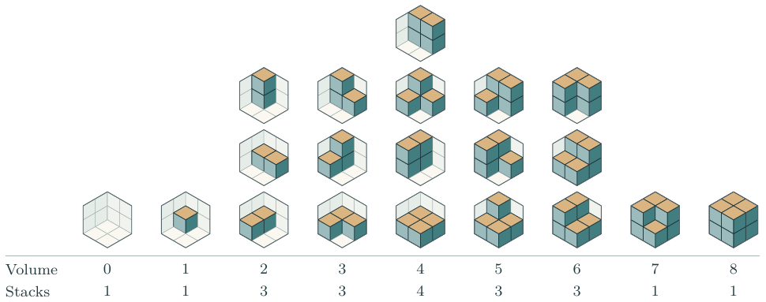

# Boxes with cyclic tiling groups have one layer or size 2 × 2 × 4

There are twenty ways to stack cubes in a one-layer box with a 3 × 3 floor and twenty ways in a 2 × 2 × 2 box. The tiling groups of these boxes both have order twenty. One generator suffices for the flat box, while the other group needs two. This paper proves Conlon’s conjecture that a box has a cyclic tiling group exactly when it has one layer or its dimensions are 2 × 2 × 4 in some order.

For every box, the paper also gives the minimum number of generators. It is the greatest multiplicity of a cyclotomic factor of prime-power index in MacMahon’s volume polynomial. The paper determines all Smith factors of the weighted Carlitz matrix over the rational Laurent polynomial ring.

[Read the illustrated paper](output/pdf/boxed-plane-partitions.pdf) · [LaTeX source](paper/boxed-plane-partitions.tex)



## Reproduce the computations

From the repository root, use Python 3.10 or later with SymPy 1.14.0.

```sh
python3 -m pip install -r checks/requirements.txt
python3 checks/verify.py
```

The command runs six programs and compares their outputs with the bundled results.

| Program under `checks/` | Calculation |
| --- | --- |
| `verify_smith.py` | Gcds for all 453 positive-size polynomial minors of nine weighted matrices |
| `verify_interval.py` | 2,275 interval and prime pairs for Gaussian binomial gcds |
| `verify_cofactors.py` | Schur expansions and cyclotomic divisibility of 65 cofactors |
| `arithmetic/verify.py` | Modular ranks and primary groups for 1,918 box and prime pairs |
| `arithmetic/check-addenda.py` | Bounds in the cyclicity proof and integer Smith factors for boxes with a side of length two |
| `independent-checks.py` | Independent polynomial and integer calculations, including the integer Smith forms of all 364 boxes with ordered side lengths at most twelve |

The last program was written by the independent auditor. The [review record](review/independent-audit.json) identifies the draft and the scope of the mathematical and exposition audit.

## Build the paper

From the repository root, run the following with Python 3 and a TeX installation that provides pdfLaTeX, Latin Modern, TikZ, and the packages named in the manuscript preamble.

```sh
python3 tools/build_paper.py
```

The build writes the paper to `output/pdf/boxed-plane-partitions.pdf`. The [figure directory](paper/figures/) includes the editable drawings and the three vector PDFs used in the paper. To rebuild one of those three plates, run pdfLaTeX on its standalone TeX file from that directory.

## Authorship and licenses

twinheterodox · Prepared with Codex. The manuscript, figures, and explanatory text are offered under [CC BY 4.0](https://creativecommons.org/licenses/by/4.0/). The computer programs are distributed under [Apache-2.0](LICENSE).
